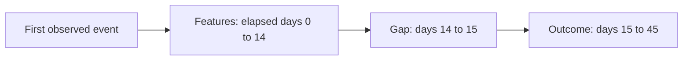

# E-Commerce Retention Analysis

Can a visitor's first two weeks of activity help rank who returns in the following month? Using Retailrocket events, this project compares logistic regression and XGBoost with simple behavioral rules.

At a 10% outreach capacity, I would start with recency: it captured 31.1% of later returners versus 31.2% for XGBoost, with no clear capture advantage in the bootstrap comparison. The model's higher average precision did not translate into a useful gain at that capacity.

## Results

The cohort contains 991,833 visitors with complete follow-up; 3.5% returned. Validation AP selected full-feature XGBoost with depth 4 and 100 trees. Removing recency and related features caused the largest ablation loss; intent and tuning added little.

Recorded results on the later 114,973-visitor holdout, where 2.7% returned:

| Ranking | AP | Capture at 5% | Capture at 10% | Capture at 20% |
| --- | --- | --- | --- | --- |
| XGBoost, depth 4 | 0.10317 | 23.7% | 31.2% | 40.8% |
| Recency | 0.08690 | 23.5% | 31.1% | 40.5% |
| Active days | 0.07250 | 21.8% | 28.7% | 36.6% |
| Event count | 0.05413 | 14.6% | 23.3% | 37.6% |
| High-intent count | 0.03005 | 7.3% | 12.2% | 21.9% |

Capture is the share of all returners found among selected visitors.

A paired visitor bootstrap found an AP advantage over recency, but capture-difference intervals included zero at all three capacities. These intervals condition on fixed predictions; notebook 02 reports the estimates and limitations. The holdout was previously inspected, so this is an additional chronological evaluation.

## Windows and dates

Each visitor's clock starts at their first event in this log, which may not be their first-ever visit. The target is any recorded event in the outcome window, including a view.



All windows exclude their upper boundary. Eligibility requires the log to extend at least 45 days after first observation.

The outcome measures visitor return, including browsing, rather than purchase retention. The two-week feature window allows repeat activity to appear, while the one-day gap allows a possible batch handoff before outreach. These durations are fixed assumptions, not optimized choices.

Training uses labels available before validation scoring on July 3-7, 2015. The selected model is refit with labels available by August 8 and evaluated on visitors scored from that date. Notebook 02 gives the exact cohort cutoffs. The 139-calendar-day log leaves only five validation scoring days, limiting evidence about stability over time.

## Optional: campaign experiment planning

Notebook 03 illustrates how to test whether contact adds more returns in the next score decile than in the top decile. It compares assumed effects over 500 simulated experiments and calculates a sample-size target. The effects are hypothetical, historical rates are not verified no-contact rates, and the dataset does not identify a reachable campaign cohort.

## Run

```bash
git clone https://github.com/chanethan408/ecommerce-retention-analysis.git
cd ecommerce-retention-analysis
conda env create -f environment.yml
conda activate ecommerce-retention-analysis
```

Download `events.csv` from the [Kaggle Retailrocket Dataset](https://www.kaggle.com/datasets/retailrocket/ecommerce-dataset?resource=download&select=events.csv) into `data/raw/`.

```bash
python -m pytest
jupyter lab
```

Run notebooks 01 and 02 in order, restarting each kernel first:

1. `01_eda.ipynb`: inspect coverage, activity, and data quality.
2. `02_return_prediction.ipynb`: build the cohort, compare rankings, and export validation scores. Running all cells includes holdout refitting and the bootstrap.

Optionally run `03_campaign_experiment_simulation.ipynb` for experiment planning. It requires notebook 02's score export; the holdout section is not required.

The pipeline can also run as `python src/data_pipeline.py`. Generated files stay local. Rerun notebook 02's export after changing the data or analysis; its accompanying JSON records the selected model configuration.
